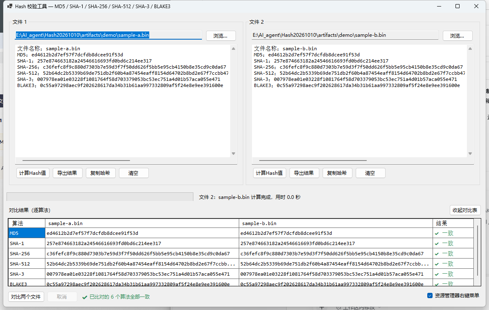

# Hash 校验工具

C# / WinForms 文件哈希校验与对比工具。一次读取同时算出 **MD5 / SHA-1 / SHA-256 / SHA-512 / SHA-3 / BLAKE3** 六种摘要，支持两个文件逐算法对比，可导出 TXT 结果，并集成到 Windows 资源管理器右键菜单。



---

## 1. 直接使用

```
C:\Users\DongHao\AppData\Local\HashCheck\HashCheck.exe
```

程序已安装到用户目录（5 个文件，约 0.3 MB；本机已装 .NET 10 桌面运行时，无需再装运行时）。

> ### ⚠️ 不要直接运行工作区里的 exe
>
> `E:\AI_agent\Hash20261010\dist\HashCheck.exe`（以及 `src\...\bin` 下的产物）**只作为构建产物**，日常使用请用上面用户目录里的安装副本。
>
> 原因：本工作区被 DSH 沙箱标记为「**低完整性**」，从工作区内启动的 exe 也会以低完整性运行；Windows 的强制完整性策略禁止低完整性进程写入桌面、文档、D 盘等正常目录，于是「导出结果」会失败并提示 `Access to the path ... is denied`（只能往工作区内部写）。用户目录下的安装副本是正常的中完整性，不受影响。
>
> 更新程序：先双击 `build.cmd`（编译 + 同步到 `dist` + 自检），再双击 `install.cmd`（复制到用户目录并重新注册右键菜单）。这两个脚本请在资源管理器里双击运行，不要在本会话的沙箱内运行。

### 界面说明（方案 B：双栏 + 逐算法对比表）

- 左右两栏 = 两个文件：路径框（只读）+「浏览…」+ 结果文本框 + `计算Hash值` / `导出结果` / `复制哈希` / `清空`
- 结果文本框**不自动换行**、带横向滚动条，内容与导出的 TXT 完全一致
- 把文件**拖进面板**即可直接开始计算
- 结果框上**点右键**可以只复制某一个算法的值（核对官网公布值时最常用）
- 点「对比两个文件」后，下方展开逐算法对照表：✔ 一致（绿）/ ✘ 不一致（红）/ — 未比对
  - 两个文件大小不同时直接判定「内容必然不同」，不做无谓的哈希计算
- 计算过程中显示进度条、已算字节、速度，可随时「取消」
- 右下角「资源管理器右键菜单」勾选框 = 一键注册 / 注销右键菜单

---

## 2. 输出格式

文本框内容 == 导出的 TXT 内容，严格如下 7 行：

```
文件名称：setup.exe
MD5：900150983cd24fb0d6963f7d28e17f72
SHA-1：a9993e364706816aba3e25717850c26c9cd0d89d
SHA-256：ba7816bf8f01cfea414140de5dae2223b00361a396177a9cb410ff61f20015ad
SHA-512：ddaf35a193617abacc417349ae204131…
SHA-3：3a985da74fe225b2045c172d6bd390bd855f086e3e9d525b46bfe24511431532
BLAKE3：6437b3ac38465133ffb63b75273a8db548c558465d79db03fd359c6cd5bd9d85
```

- 摘要为**小写十六进制**；对比时忽略大小写与首尾空白
- SHA-3 采用 **SHA3-256**（FIPS 202，不是 Keccak-256）
- BLAKE3 固定 **32 字节输出**（64 位十六进制），与官方 `b3sum` 默认一致

### 导出规则

- 位置：**被校验文件所在目录**
- 文件名：**原文件名去掉扩展名 + `_Hash校验结果.txt`**
  - `setup.exe` → `setup_Hash校验结果.txt`
  - `a.tar.gz` → `a.tar_Hash校验结果.txt`（只去掉最后一段扩展名）
- 编码：**UTF-8 带 BOM + CRLF**，中文内容在记事本及较老工具中都不会乱码
- 同名文件已存在 → 询问「覆盖 / 自动重命名 / 取消」
- 目录不可写（只读盘、Program Files、只读共享）→ 提示并弹出「另存为」
- **导出成功后不弹任何提示框、也不打开资源管理器**，只在窗口底部状态栏显示 `已导出：<完整路径>`

---

## 3. 资源管理器右键菜单

选中文件 → 右键，出现两项：

| 菜单项 | 等价命令行 |
|---|---|
| 计算Hash值 | `HashCheck.exe --calc "%1"` |
| 计算Hash并导出 | `HashCheck.exe --calc-export "%1"` |

- 当前注册到：`C:\Users\DongHao\AppData\Local\HashCheck\HashCheck.exe`
- 只写 `HKCU\Software\Classes\*\shell`，**不需要管理员权限**，只影响当前用户
- `MultiSelectModel = Player`：多选文件时会逐个处理
- **Windows 11 提示**：这类静态菜单项位于右键菜单的「**显示更多选项**」二级菜单里（或按 `Shift+F10` / `Shift+右键`）；这是 Windows 11 自身的行为，出现在一级菜单需要额外的 MSIX 稀疏包机制
- 注册 / 注销：程序右下角勾选框，或 `HashCheck.exe --register` / `--unregister`，或双击 `install.cmd`
- 注册表里记录的是**注册时的 exe 路径**：换目录后重新注册一次（勾选框取消再勾选，或重跑 `install.cmd`）

---

## 4. 命令行参数

```
HashCheck.exe                        启动界面
HashCheck.exe <文件> [文件]           载入文件并计算（第二个文件进右栏，自动对比）
HashCheck.exe --calc <文件> [文件]    同上
HashCheck.exe --calc-export <文件>    计算并导出 TXT（不弹确认框）
HashCheck.exe --register             注册资源管理器右键菜单（当前用户）
HashCheck.exe --unregister           注销资源管理器右键菜单
HashCheck.exe --selftest [报告文件]   运行内置自检，退出码 0 = 全部通过
```

命令行模式会把运行日志写到 `%TEMP%\HashCheck.startup.log`（GUI 程序没有控制台，出问题时看它）。

---

## 5. 自检（标准测试向量）

```
HashCheck.exe --selftest artifacts\selftest.txt
```

用公开标准测试向量验证实现与集成，覆盖空文件与 `"abc"` 两组输入的全部 6 个算法，另外验证：

- 5120 字节输入（跨 BLAKE3 的 1024 字节 chunk 边界）：流式结果 == 一次性结果（BLAKE3 / SHA-256 / SHA-3）
- SHA-512 摘要长度 128、BLAKE3 摘要长度 64
- 显示格式（7 行、算法名顺序）、导出文件命名规则

当前结果：**全部通过**（报告见 `artifacts\selftest.txt`）。

---

## 6. 从源码构建

需要 **.NET 10 SDK**（本机装在 `%LOCALAPPDATA%\Microsoft\dotnet`）。

- `build.cmd`：编译（Release）+ 同步到 `dist` + 跑自检
- `install.cmd`：把 `dist` 复制到 `%LOCALAPPDATA%\HashCheck` 并注册右键菜单

手动构建：

```cmd
set NUGET_PACKAGES=%~dp0.nuget\packages
"%LOCALAPPDATA%\Microsoft\dotnet\dotnet.exe" build src\HashCheck\HashCheck.csproj -c Release
```

工程结构：

```
src/HashCheck/
  HashCheck.csproj        net10.0-windows / WinForms，唯一依赖 NuGet 包 Blake3
  app.manifest            长路径支持、UTF-8 活动代码页、asInvoker
  Program.cs              入口、命令行解析、启动日志
  Hashing/
    HashCatalog.cs        算法清单 + SHA-3 两级探测（IncrementalHash → SHA3_256.Create）
    Blake3Step.cs         BLAKE3（NuGet 包 Blake3，全托管 SIMD，固定 32 字节输出）
    HashEngine.cs         单次读取算全部算法、进度、文件被改动检测
    HashResult.cs         结果模型 + 显示/导出文本生成
  Services/
    ExportService.cs      导出路径与唯一命名、UTF-8 BOM 写入
    ShellIntegration.cs   HKCU 右键菜单注册/注销/查询
    SelfTest.cs           标准测试向量自检
  UI/
    FilePanel.cs          单个文件面板（路径、结果、按钮、拖放、右键复制单项）
    MainForm.cs           双栏布局、进度、对比表、导出、右键菜单开关
```

### 实现要点

- **一次读取算 6 个算法**：文件只从磁盘读一遍（1 MiB 缓冲 + `ArrayPool`），同一块数据同时喂给 6 个算法实例，而不是读 6 遍。几十 GB 的文件差距明显
- 用 `FileShare.ReadWrite | FileShare.Delete` 打开，**被其他程序占用的文件也能算**
- **流式**处理，绝不整文件读入内存
- 计算前后比对 `大小 + 修改时间`，若文件在计算途中被改动会提示结果可能无效
- 结果按 `大小 + 修改时间` 复用：点「对比」不会重复计算未变化的文件

---

## 7. 已知限制

1. **Windows 11 把右键菜单项收在「显示更多选项」里**（见第 3 节），一级菜单需要 MSIX 稀疏包
2. 导出目录不可写时需手动「另存为」，无法自动提权写入
3. **低完整性环境下功能受限**：本工作区 `E:\AI_agent\Hash20261010` 被沙箱标记为低完整性，从其中启动的 exe 会以低完整性运行 —— 此时既无法写注册表（注册右键菜单失败），也无法导出到桌面/文档等正常目录。使用 `%LOCALAPPDATA%\HashCheck` 下的安装副本即可完全避免（见第 1 节）
4. 符号链接默认跟随（对链接指向的目标文件计算摘要）
